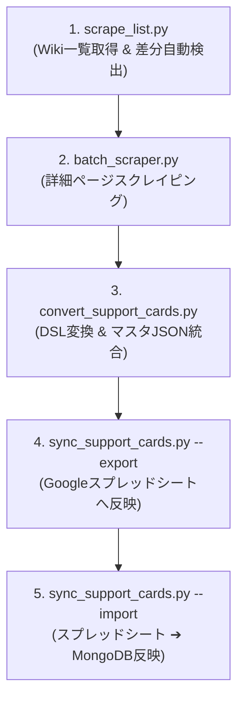

# 学園アイドルマスター サポートカード スクレイパー (gakumas-support_cards)

このディレクトリには、Seesaa Wikiから学園アイドルマスターのサポートカード情報を収集し、シミュレーターおよび Out-game ツールで利用可能な DSL（ドメイン固有言語）形式の JSON データに変換・管理するためのスクリプト群が含まれています。

---

## ⚙️ 前提条件（環境セットアップ）

スクリプトを実行する前に、ワークスペース共通の Python 仮想環境を有効化してください。

```bash
# 仮想環境の有効化
source /root/gakumas-workspace/.venv/bin/activate

# 当該ディレクトリへ移動
cd /root/gakumas-workspace/gakumas-support_cards
```

---

## 🚀 メインワークフロー（データ更新手順）

定期的な新カード追加時やマスタ更新時は、以下の手順で実行します。



### 1. カード一覧の取得 & 新規カード自動検出 (`scrape_list.py`)
Wikiの「サポートカード一覧」ページをスクレイピングし、全カードの基本情報（レアリティ、カード名、Wiki ID、URL）を取得して `support_cards.csv` を更新します。
取得完了後、既存マスタデータとの差分を自動比較し、**新規追加されたカードの一覧をターミナルに表示**します。

- **入力**: Seesaa Wiki サポートカード一覧ページ
- **出力**: `support_cards.csv`
- **実行**:
  ```bash
  python3 scrape_list.py
  ```

---

### 2. （任意）手元データでの差分確認 (`check_new_cards.py`)
Wikiへの通信を行わず、手元の `support_cards.csv` とマスタ JSON（`support_cards_master.json`）の差分のみを即座に確認できます。

- **実行**:
  ```bash
  python3 check_new_cards.py
  ```

---

### 3. 詳細データの一括取得 (`batch_scraper.py`)
`support_cards.csv` を読み込み、各カードの詳細ページを巡回してアビリティや獲得スキルカード等の詳細 JSON を取得・生成します。
サーバー負荷軽減のため、リクエスト間に 2 秒のインターバルを設けています。

- **入力**: `support_cards.csv`
- **出力**: `gakumas-og-tools/support-cards/` 配下の個別 JSON（`SP_SSR_xxxx.json` 等）
- **実行**:
  - **新カードのみ取得（高速・推奨）**:
    ```bash
    python3 batch_scraper.py --new-only
    ```
  - **全カードを一括再取得（デフォルト）**:
    ```bash
    python3 batch_scraper.py
    ```

> [!TIP]
> - `--new-only`（または `-n`）を指定すると、まだ個別 JSON が作成されていない新カードのみを抽出してスクレイピングするため、時間を大幅に短縮できます。
> - 特定のカード 1 枚のみを取得・デバッグしたい場合は、単体スクリプトを直接実行できます：
>   ```bash
>   python3 scraper.py "https://seesaawiki.jp/gakumasu/d/カード名URL"
>   ```

---

### 4. DSL 変換とマスタ JSON の結合 (`convert_support_cards.py`)
個別 JSON の日本語テキスト（例：「ボーカル上昇+65」）をシミュレーター用 DSL 構文（例：`vo+65`）に変換し、1 つの統合マスタファイル（`support_cards_master.json`）を生成します。

- **入力**: 個別 JSON ファイル群
- **出力**: `gakumas-og-tools/support_cards_master.json`
- **実行**:
  ```bash
  cd /root/gakumas-workspace/gakumas-og-tools
  python3 scripts/convert_support_cards.py
  ```

---

### 5. Google スプレッドシート / MongoDB への同期 (`sync_support_cards.py`)

#### A. 新カードをスプレッドシートへ反映（エクスポート）
生成された最新マスタを Google スプレッドシート（`Support-Cards` タブ）へエクスポートし、新カードの行を追加します。

```bash
cd /root/gakumas-workspace/gakumas-og-tools
# Dry-run 確認
python3 scripts/sync_support_cards.py --export

# 本反映
python3 scripts/sync_support_cards.py --export --execute
```

#### B. 所持状況・育成状況を DB へ取り込み（インポート）
スプレッドシート上で所持フラグ（`TRUE`/`FALSE`）や特訓段階（凸）・Lvを編集した後、MongoDB へ反映します。

```bash
cd /root/gakumas-workspace/gakumas-og-tools
# Dry-run 確認
python3 scripts/sync_support_cards.py --import

# 本反映
python3 scripts/sync_support_cards.py --import --execute
```

---

## 🛠️ 品質チェック・保守スクリプト

- **`check_nulls.py`**
  スクレイピング済みの全 JSON を検査し、「獲得スキルカード」と「獲得Pアイテム」の両方が `null` になっているパース漏れカードがないか検証します。
  ```bash
  python3 check_nulls.py
  ```

- **`migrate_db.py`**
  MongoDB 内の所持カードデータの旧 ID（日本語名等）を、`support_cards.csv` に基づいて正式な `wiki_id`（例: `SP_SSR_xxxx`）へ一括置換します（実行時に自動バックアップを作成）。

- **`fix_hearts.py`**
  特殊文字（♡など）が文字化けして `&#9825;` となってしまったカード ID を修正するホットフィックスツールです。
