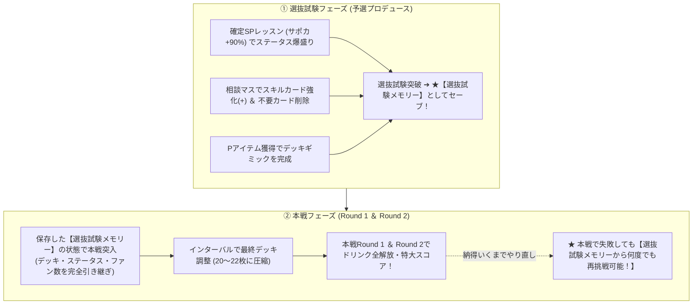
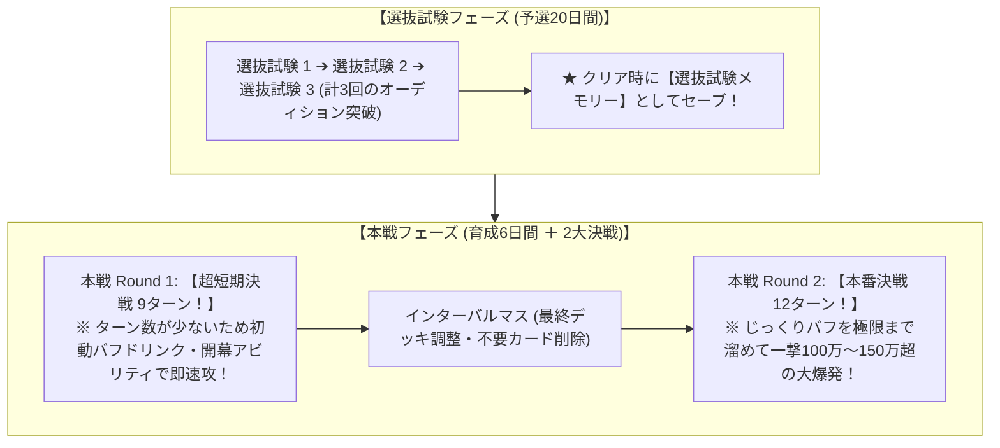
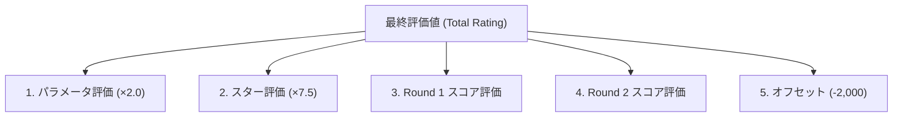

# 00. H.I.F. シナリオ概要と評価値（Produce Rating）計算メカニズム

## 1. シナリオ概要と二部構成メカニズム（選抜試験 ➔ 本戦）

「H.I.F.（Hatsuboshi IDOL FESTIVAL）」は、高い戦略性とデッキ構築力が求められる最高峰の育成シナリオです。
本シナリオは **「選抜試験（予選プロデュース）」** と **「本戦（Round 1 ＆ Round 2）」** の明確な二部構成になっています。

### 🌟 Web・有志検証で判明した【H.I.F. 攻略の絶対鉄則】

1. **「選抜試験メモリー」による本戦無限再挑戦システム**:
   - 選抜試験をクリアすると、その時点のデッキ・ステータス・獲得ファン数が **「選抜試験メモリー」** として保存されます。
   - 本戦（Round 1 / Round 2）で手札事故が起きたりスコアが届かなくても、**保存した選抜試験メモリーを使って「本戦から何度でも再挑戦（リトライ）」が可能** です！
   - **➔ 攻略の極意**: まずは選抜試験で最高の上振れ（カンスト級ステータス＋強化済みデッキ＋大量ファン数）を作り、それをセーブしてから本戦で最高スコアが出るまでリトライを繰り返すのが S4+ / S5 達成の王道です。

2. **デッキ圧縮（20〜22枚前後）**:
   - 不要カードを徹底的に削除・除外し、強力な固有スキルやコンボパーツ（『絶対に負けない+』『国民的アイドル+』等）を確実に手札に引き込めるようデッキ枚数を絞り込みます。

3. **本戦インターバルでのデッキ調整**:
   - 本戦中のインターバルマスを活用して、最後のスキルカード収集とデッキの微調整を行います。

4. **Pドリンクの各Round完全使い切り**:
   - ドリンクはRoundごとにすべて使い切る前提で開幕バフ・フィニッシュ倍率を最大化させます。

---

## 2. 試験構成とターン数（予選 3回 ➔ 本戦 2回）

H.I.F. では、各試験の **「ターン数の違い」** を理解した立ち回りが極めて重要です。

### ⏱️ 本戦 Round 1 (9T) vs Round 2 (12T) の戦略差

| 試験 | ターン数 | 特徴と難所 | 最適な立ち回り・対策 |
| :--- | :---: | :--- | :--- |
| **本戦 Round 1** | **9ターン** (超短期決戦) | **【最難関・スコアが稼ぎにくい】** ターン数が非常に短く、通常のバフ積みをしているとフィニッシュ前に終わってしまう。 | ・**開幕Pドリンクの即時投入**（集中付与、好調付与など） ・**開幕バフアビリティ**（`@exam_start: focus+3` 等） ・初動カード（『静かな意志+』『眼力+』）で1〜2ターン目にバフを完成させ、中盤から即アピールを開始する。 |
| **インターバル** | - | Round 1 後の特殊相談マス。 | ・最後の不要カード削除（デッキ圧縮 20〜22枚）。 ・Round 2 用の最強 Pドリンク（2〜3本）を補充。 |
| **本戦 Round 2** | **12ターン** (本格長期決戦) | **【最高評価 S4+/S5 達成の主戦場】** 12ターンあるため、バフを極限まで積み上げて終盤に特大スコア（150万点超）を狙える。 | ・1〜4T: 集中・好調・やる気・元気を徹底蓄積。 ・5〜8T: 山札除外圧縮で高火力カードを引き込む。 ・9〜12T: 『国民的アイドル+』＋Pドリンク全解放から、固有カード連打で超大打点！ |

---

## 3. 評価値（Produce Rating）完全計算式

H.I.F. における最終評価値は、以下の確定数式によって算出されます。

$$\text{Total Rating} = \text{ParamRating} + \text{StarRating} + \text{Round1Rating} + \text{Round2Rating} - 2000$$

---

### ① パラメータ評価（ParamRating）

各パラメータ（Vo, Da, Vi）の上限は **3,200**（3属性合計で最大 9,600）です。

$$\text{TotalStats} = \min(\text{Vo}, 3200) + \min(\text{Da}, 3200) + \min(\text{Vi}, 3200)$$
$$\text{ParamRating} = \text{TotalStats} \times 2.0$$

- **理論値最大**: $9,600 \times 2.0 = \mathbf{19,200\text{ pt}}$
- **S4+ の目安**: 合計 7,500〜8,500（$\rightarrow$ 15,000〜17,000 pt）

---

### ② スター評価（StarRating）

Round 2 突入前の所持スター（上限 1,110）に、Round 2 スコアに応じて獲得する「ボーナススター」（最大 150 $\times$ 1.5倍 = 225）を加算し、**7.5倍** します。

$$\text{StarRating} = \lfloor (\text{PreRound2Star} + \text{BoostedRound2StarGain}) \times 7.5 \rfloor$$

#### Round 2 スコアからのスター獲得テーブル
Round 2 で獲得したスコアに応じて、以下の段階式でスター（基礎値）が付与されます：

| Round 2 スコア範囲 | 基礎スター計算式 | 基礎スター最大 |
| :--- | :--- | :---: |
| 0 〜 400,000 | $\text{score} \times 0.0001875$ | 75 |
| 400,000 〜 600,000 | $75 + (\text{score} - 400,000) \times 0.000225$ | 120 |
| 600,000 〜 1,000,000 | $120 + (\text{score} - 600,000) \times 0.000075$ | 150 |
| 1,000,000 〜 | **150 (カンスト)** | 150 |

$$\text{BoostedRound2StarGain} = \lfloor \text{BaseStarGain} \times 1.5 \rfloor \quad (\text{最大 } 225)$$

- **スター合計最大**: $1,110 + 225 = \mathbf{1,335\text{ 個}}$
- **理論値最大評価**: $1,335 \times 7.5 = \mathbf{10,012\text{ pt}}$
- **S4+ の目安**: スター合計 1,100〜1,250個（$\rightarrow$ 8,250〜9,375 pt）

---

### ③ Round 1 スコア評価（Round1Rating）

Round 1 のスコアはまず **1.2 で除算（$\text{adjustedScore} = \lfloor \text{score} / 1.2 \rfloor$）** された後、以下の段階テーブル（Regimes）で評価値に換算されます。

| adjustedScore 範囲 | 評価値計算式 | 評価値上限 |
| :--- | :--- | :---: |
| 0 〜 300,000 | $0$ | 0 |
| 300,000 〜 700,000 | $(\text{adjScore} - 300,000) \times 0.01$ | 4,000 |
| 700,000 〜 1,000,000 | $4,000 + (\text{adjScore} - 700,000) \times 0.003$ | 4,900 |
| 1,000,000 〜 1,200,000 | $4,900 + (\text{adjScore} - 1,000,000) \times 0.002$ | 5,300 |
| 1,200,000 〜 1,400,000 | $5,300 + (\text{adjScore} - 1,200,000) \times 0.001$ | 5,500 |
| 1,400,000 〜 | **5,500 (カンスト)** (元スコア 168万以上) | 5,500 |

- **主要な実スコア目安**:
  - 実スコア **600,000**（adj: 500,000） $\rightarrow$ **2,000 pt**
  - 実スコア **840,000**（adj: 700,000） $\rightarrow$ **4,000 pt**（効率の変わり目）
  - 実スコア **1,200,000**（adj: 1,000,000） $\rightarrow$ **4,900 pt**
  - 実スコア **1,440,000**（adj: 1,200,000） $\rightarrow$ **5,300 pt**
  - 実スコア **1,680,000**（adj: 1,400,000） $\rightarrow$ **5,500 pt (最大)**

---

### ④ Round 2 スコア評価（Round2Rating）

Round 2 のスコアは直接、以下の段階テーブル（Regimes）で評価値に換算されます。

| Round 2 スコア範囲 | 評価値計算式 | 評価値上限 |
| :--- | :--- | :---: |
| 0 〜 600,000 | $0$ | 0 |
| 600,000 〜 900,000 | $(\text{score} - 600,000) \times 0.004$ | 1,200 |
| 900,000 〜 1,500,000 | $1,200 + (\text{score} - 900,000) \times 0.008$ | 6,000 |
| 1,500,000 〜 2,000,000 | $6,000 + (\text{score} - 1,500,000) \times 0.002$ | 7,000 |
| 2,000,000 〜 2,400,000 | $7,000 + (\text{score} - 2,000,000) \times 0.001$ | 7,400 |
| 2,400,000 〜 | **7,400 (カンスト)** | 7,400 |

- **主要な実スコア目安**:
  - スコア **900,000** $\rightarrow$ **1,200 pt**
  - スコア **1,200,000** $\rightarrow$ **3,600 pt**
  - スコア **1,500,000** $\rightarrow$ **6,000 pt**（★最も伸びが大きい重要ゾーン）
  - スコア **2,000,000** $\rightarrow$ **7,000 pt**
  - スコア **2,400,000** $\rightarrow$ **7,400 pt (最大)**

---

### ⑤ 全体オフセット（RATING_OFFSET）

$$\text{RATING\_OFFSET} = \mathbf{-2,000\text{ pt}}$$

計算の最後に必ず一律で **2,000 pt が減算** されます。

---

## 4. 総合評価のシミュレーション例

### 💡 例1: S4+ 達成（30,025 pt）の標準ケース
- **ステータス**: Vo 2,800 + Da 2,600 + Vi 2,400 = 7,800
  - $\rightarrow \text{ParamRating} = 7,800 \times 2 = \mathbf{15,600\text{ pt}}$
- **スター**: 前半 950個 + R2ボーナス 200個 = 1,150個
  - $\rightarrow \text{StarRating} = 1,150 \times 7.5 = \mathbf{8,625\text{ pt}}$
- **Round 1 スコア**: 1,000,000（adj: 833,333）
  - $\rightarrow \text{Round1Rating} = 4,000 + (133,333 \times 0.003) = \mathbf{4,400\text{ pt}}$
- **Round 2 スコア**: 1,400,000
  - $\rightarrow \text{Round2Rating} = 1,200 + (500,000 \times 0.008) = \mathbf{5,200\text{ pt}}$
  - $\rightarrow \text{StarGain} = 150 \times 1.5 = 225$（上記スター加算に反映）
- **オフセット**: $-2,000$

$$\text{合計} = 15,600 + 8,625 + 4,400 + 5,200 - 2,000 = \mathbf{31,825\text{ pt (S4+ 余裕クリア！)}}$$

