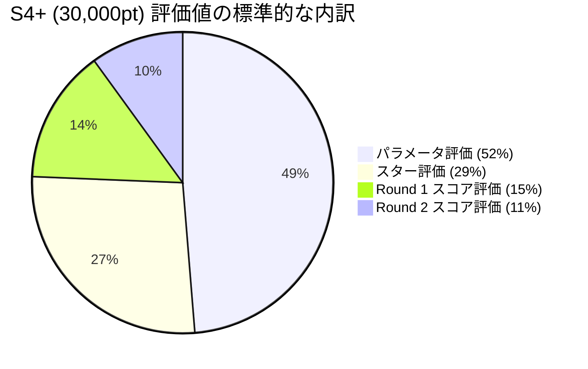
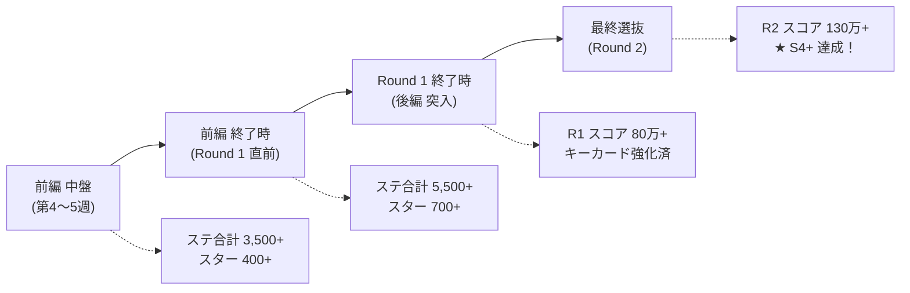

# 01. S4+ 目標配分モデル & 逆算ボーダー表

## 1. S4+（評価値 30,000 pt）達成の 4 大配分モデル

H.I.F. で S4+（30,000 pt）を達成するための代表的なパラメータ・スター・スコア配分パターンです。
手持ちのサポートカードや Pアイドルの特性（ステータスが伸びやすいか、スコア倍率が高いか等）に合わせて目指すモデルを選択します。

*(※上記に加え、一律 -2,000pt のオフセットが適用されます)*

---

### 📊 モデル比較表

| モデル名 | 総ステータス | preR2スター | R1 スコア | R2 スコア | 合計評価値 | 特徴・向いている編成 |
| :--- | :---: | :---: | :---: | :---: | :---: | :--- |
| **① 王道バランス型** | **7,800** (15,600pt) | **950個** (8,812pt) | **900,000** (4,150pt) | **1,400,000** (5,200pt) | **31,762 pt** (余裕クリア) | 最も事故が少なく安定。全プラン（センス/ロジック/アノマリー）推奨 |
| **② 高ステータス型** | **8,600** (17,200pt) | **850個** (8,062pt) | **750,000** (3,250pt) | **1,200,000** (3,600pt) | **30,112 pt** | サポカ凸が進んでおり、レッスンでステータスを極限まで盛れる場合 |
| **③ スコア爆発型** | **7,200** (14,400pt) | **900個** (8,437pt) | **1,200,000** (4,900pt) | **1,600,000** (6,200pt) | **31,937 pt** | センス絶好調型やアノマリー全力型で一撃の超大打点が出せる場合 |
| **④ スター特化型** | **7,400** (14,800pt) | **1,050個** (9,562pt) | **800,000** (3,666pt) | **1,350,000** (4,800pt) | **30,828 pt** | フェス動員重視のスケジュール・アビリティを採用した場合 |

---

## 2. Round 2 必要スコア逆算表（Target Round 2 Scores）

Round 1 終了時点で手持ちの「総ステータス」「preRound2Star」「Round 1 スコア」が確定した際、**S4+（30,000 pt）および S4（26,000 pt）に届くために Round 2 で何万点出す必要があるか** の早見表です。

### 📌 前提: Round 1 スコア = 900,000（評価値 4,150 pt）の場合

| 総ステータス (Vo+Da+Vi) | preR2 スター数 | S4+ (30,000pt) 必要 R2 スコア | S4 (26,000pt) 必要 R2 スコア | S5 (35,000pt) 必要 R2 スコア |
| :---: | :---: | :---: | :---: | :---: |
| **8,500** | 1,000 個 | **約 92 万点** | 達成済み (0点) | 約 175 万点 |
| **8,500** | 900 個 | **約 105 万点** | 達成済み (0点) | 約 190 万点 |
| **8,000** | 1,000 個 | **約 117 万点** | 達成済み (0点) | 約 215 万点 |
| **8,000** | 900 個 | **約 130 万点** | 約 65 万点 | 約 235 万点 |
| **7,500** | 1,000 個 | **約 142 万点** | 約 78 万点 | 達成困難 |
| **7,500** | 900 個 | **約 155 万点** | 約 90 万点 | 達成困難 |
| **7,000** | 1,000 個 | **約 168 万点** | 約 102 万点 | 達成困難 |
| **7,000** | 850 個 | **約 185 万点** | 約 118 万点 | 達成困難 |

> [!TIP]
> **スコア 90万 〜 150万 の急上昇ゾーンを活用する**:
> Round 2 評価値は 90万点から 150万点の間で **1万点あたり +80 pt** という極めて高いレートで伸びます。
> 120万点から 150万点へ 30万点伸ばすだけで **評価値が +2,400 pt** も跳ね上がります！

---

## 3. 進行段階別チェックポイント（あさり先生の診断基準）

プロデュース中の各段階で、S4+ 達成に向けた順調度をチェックするための目安です。

### ① 前編 中盤（第4〜5週）
- **ステータス合計**: **3,500 〜 4,000**
- **スター数**: **400 〜 500 個**
- **チェックポイント**:
  - 得意属性の SPレッスンを踏めているか？
  - トラブルカード（眠気等）の除外・圧縮の目処が立っているか？

### ② 前編 終了時（Round 1 直前）
- **ステータス合計**: **5,500 〜 6,000**
- **スター数**: **700 〜 800 個**
- **チェックポイント**:
  - Round 1 で 80万点以上を出せるデッキコンボが揃っているか？
  - Pドリンクの無駄遣いをしていないか？

### ③ Round 1 終了時（後編 突入）
- **Round 1 スコア**: **800,000 〜 1,000,000**（評価値 4,000〜4,400pt 圏内）
- **チェックポイント**:
  - ここで 84万点（adj 70万点）を超えると、評価値換算の効率が一気に安定します。
  - 後編での残り必要ステータス・スター数を逆算し、レッスンと相談の比率を調整します。

### ④ Round 2 直前
- **ステータス合計**: **7,800 〜 8,200**
- **preRound2 スター数**: **950 〜 1,050 個**
- **チェックポイント**:
  - Round 2 用の強力な Pドリンク（開幕バフ、スコアブースト等）を 2〜3本 保持しているか？
  - 上記の逆算表から「目標スコア（例: 135万点）」を明確にして最終試験に挑みます。

