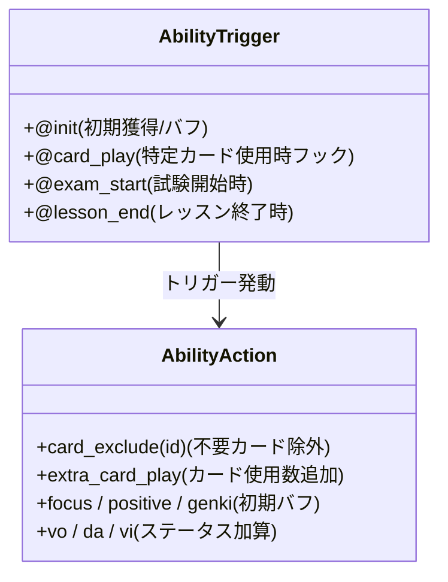
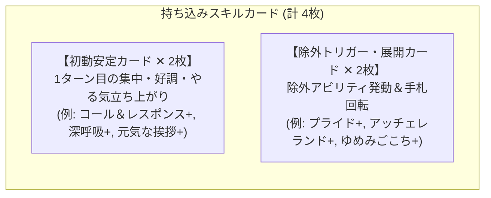

# 02. プロデュースアビリティ・メモリー選定と DSL Ver 1.2 仕様

## 1. H.I.F. におけるメモリーとアビリティの重要性

H.I.F. シナリオでは、プロデュース開始時に持ち込む **「プロデュースメモリー」のアビリティ** が、ステータスの伸びと試験中のスコア爆発力（特に Round 1 / Round 2）を大きく左右します。

### メモリーの基本仕様
- **メインメモリー（1枚）**:
  - ステータス加算: **100% 反映**
  - アビリティ効果: すべて発動
  - 初期配布スキルカード: 100% 手札・山札に供給
- **サブメモリー（複数枚）**:
  - ステータス加算: **20% のみ反映**（例: Vo+100 のサブメモリーは実効 Vo+20）
  - アビリティ効果: すべて発動（アビリティの強度が最優先！）

---

## 2. out-game DSL Ver 1.2 準拠: H.I.F. 特有アビリティ一覧

H.I.F. で登場するプロデュースアビリティは、`shared/agent-instructions/gemini-code-1781662959066.md` で定義された DSL Ver 1.2 構文に従って定義されています。

---

### ① カード除外アクション（Deck Compression）
- **DSL 構文**: `@card_play(id=(対象カードID)): card_exclude(id=除外対象ID)(limit=回数)`
- **効果内容**:
  - 試験中、特定のキーカード（プライド、アッチェレランド等）を使用した際、山札または捨札にある指定カード（例: トラブルカード『眠気』ID: 23）を **除外領域へと移動** させます。
- **実戦メリット**:
  - デッキの回転率が劇的に向上し、Round 1 / Round 2 の後半で「強力なアピールカード」を確実に手札に引き込めるようになります。

### ② スキルカード使用数追加（Extra Card Play）
- **DSL 構文**: `@exam_start(type=final): extra_card_play+1(limit=回数)`
- **効果内容**:
  - 試験中、1ターンに使用できるスキルカードの上限枚数を +1 します。
- **実戦メリット**:
  - 1ターンあたりのバフ蓄積（集中・好調・やる気等）とスコアアタックを同一ターンに実行可能になり、最終ターンの超大打点を実現します。

### ③ 初期配布カード & 初期バフ（Initial Inventory & Buffs）
- **DSL 構文**:
  - `@init: card_id=(スキルカードID)`
  - `@exam_start: focus+3` / `@exam_start: positive+3` / `@exam_start: genki+5`
- **実戦メリット**:
  - 1ターン目から事故なく立ち上がることができ、Round 1 / Round 2 の立ち上がりターン数を大幅に節約できます。

---

## 3. プラン別 推奨メモリー・アビリティ構成

### 🔴 センスプラン（好調・集中型）
| スロット | 推奨アビリティ / 初期カード | 狙い・シナジー |
| :--- | :--- | :--- |
| **メイン** | 『コール＆レスポンス+』 or 『深呼吸+』持ち込み `@init: card_id=...` | 序盤の集中・好調を最速で立ち上げる |
| **サブ 1** | `@card_play(id=(420,421)): card_exclude(id=23)` | 『プライド』使用時に『眠気』を除外して手札事故を根絶 |
| **サブ 2** | `@exam_start(type=final): extra_card_play+1(limit=1)` | 最終試験の勝負ターンで集中加算＋アピール連打 |
| **サブ 3〜** | レッスンボーナス（`vo_lesson_bonus`, `da_lesson_bonus`） | 総ステータス 7,800〜8,500 の達成 |

### 🔵 ロジックプラン（好印象・やる気型）
| スロット | 推奨アビリティ / 初期カード | 狙い・シナジー |
| :--- | :--- | :--- |
| **メイン** | 『元気な挨拶+』 or 『届いて！+』持ち込み | 1ターン目からの好印象・元気蓄積 |
| **サブ 1** | `@card_play: card_exclude(id=23)` | 山札圧縮により、毎ターン確実に好印象・やる気カードを引く |
| **サブ 2** | `@exam_start: positive+4` または `@exam_start: genki+6` | 開幕から高倍率の好印象・元気恩恵を享受 |
| **サブ 3〜** | レッスンボーナス & SPレッスン発生率 | ステータス底上げと Pポイント確保 |

### 🟣 アノマリープラン（強気・温存・全力型）
| スロット | 推奨アビリティ / 初期カード | 狙い・シナジー |
| :--- | :--- | :--- |
| **メイン** | 『アッチェレランド+』持ち込み `@init: card_id=403` | 強気スタンス突入とコスト軽減の起点 |
| **サブ 1** | `@card_play(id=(402,403)): card_exclude(id=23)` | アッチェレランド使用時の除外圧縮 |
| **サブ 2** | `@exam_start: extra_card_play+1` | 全力スタンス突入ターンに全力アピールカードを複数枚叩き込む |
| **サブ 3〜** | 全力値増加アビリティ / ステータスボーナス | 全力スタンス突入のターン数を短縮 |

---

## 4. プロデュース開始時の持ち込みスキルカード（計 4枚）選定基準

プロデュース開始時、メモリー経由で手札・山札に持ち込むべき **4枚のスキルカード** の黄金比率です。

1. **初動立ち上がり用（2枚）**:
   - 1ターン目に手札に来て嬉しい、低コスト・高効率なバフカード（すべて **+版**）。
2. **除外アビリティトリガー用（2枚）**:
   - サブメモリーの `card_exclude` を発動させるキーカード（『プライド+』『アッチェレランド+』等）。

---

## 5. プロデュース完了時に完成させるべき理想メモリー仕様（目標スペック）

プロデュースを完走した際、最終的に **「どのような完成形メモリーとして持ち帰るか（ゴール）」** の定義です。

### 📋 理想メモリーの目標スペック
- **① 付与スキルカード（6枚）**:
  - メイン火力カード（2枚） ＋ バフ維持カード（2枚） ＋ 初動・除外トリガーカード（2枚）
  - **※ すべて相談マスで強化済みの「+版」であること**。
- **② 目標パラメータ**:
  - メイン属性（例: Vo/Vi）が **+80〜+100 以上**、総パラメータ **+180 以上**。
- **③ 獲得 H.I.F. アビリティ**:
  - `card_exclude`（眠気除外）または `extra_card_play`（最終試験行動追加）。

---

## 6. メモリー厳選時のチェックリスト

- [ ] **サポートカード編成**: メイン属性の SPレッスン発生率が合計 **+90% 以上（確定 100% 化）** になっているか？
- [ ] **初期持ち込みカード 4枚**: 1ターン目に腐らない初動カード 2枚 ＋ 除外トリガーカード 2枚 がセットされているか？
- [ ] **完成メモリーのスキル 6枚**: 相談マスで重要カードをすべて「+」に強化して完走できたか？
- [ ] **H.I.F. アビリティ**: 不要カード除外や追加行動アビリティが取得できているか？

