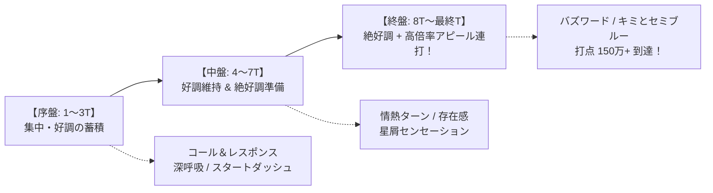
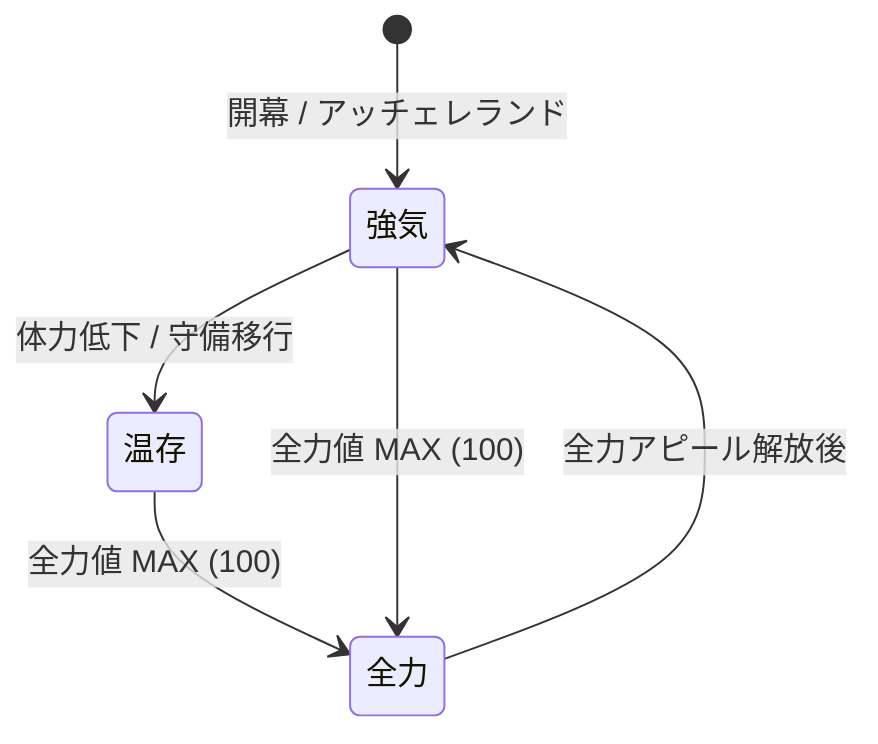

# 03. プラン別 S4+ 達成立ち回り・デッキ構築戦術

## 1. センスプラン（好調・集中・絶好調型）の戦術

センスプランは **「好調によるターンごとの倍率アップ」** と **「集中による固定値加算」**、そして **「絶好調による爆発的な最終打点」** を組み合わせ、Round 1（80万〜120万点）および Round 2（120万〜160万点）で超高スコアを狙うプランです。

### 🎯 デッキ構築の黄金比率
- **バフ・基盤カード（集中・好調）**: 4〜5枚
- **維持・ブーストカード（絶好調付与等）**: 2〜3枚
- **フィニッシャー（高倍率スコア獲得）**: 3〜4枚
- **メンタル・体力管理**: 2枚

### 💡 Round 2 で 150万点超を出すコンボ
1. **開幕〜序盤**: 『深呼吸+』『コール＆レスポンス+』で集中を 15〜20 以上に引き上げる。
2. **中盤**: 『星屑センセーション』や『情熱ターン』で好調ターン数を途切れさせずに維持。
3. **終盤（残り2〜3ターン）**:
   - Pドリンク（絶好調付与）を使用し、絶好調状態へ移行。
   - `extra_card_play` を発動させ、1ターンに『キミとセミブルー+』や『バズワード+』を連打。
   - 集中加算 $\times$ 好調・絶好調倍率により、一撃で 80万〜100万点 オーバーを叩き出します。

---

## 2. ロジックプラン（好印象型・やる気元気玉型）の戦術

ロジックプランは **「好印象による毎ターンの確実なスコア積み上げ」** または **「やる気を極限まで溜めて放つ元気玉（元気変換スコア）」** で安定した高打点を狙うプランです。フェス動員数（スター）を安定して稼ぎやすいのが特徴です。

### ① 好印象型の立ち回り
- **基本方針**:
  - 1ターン目から『元気な挨拶+』『届いて！+』等で好印象を素早く加算。
  - 好印象ターン数を延長しながら、毎ターン終了時の自動スコアを 10万〜20万点 へと増幅。
- **キーカード**:
  - 『手拍子+』『キラメキ+』『大いなる一歩+』
- **Round 2 の目標**:
  - 最終ターンまでに好印象 40〜50 以上を維持し、総ターン数全体で 120万〜140万点 を安定して削り取ります。

### ② やる気・元気玉型の立ち回り
- **基本方針**:
  - やる気・元気を蓄積し、後半に「現在の元気を参照してパラメータ加算」「元気をすべてスコアに変換」するカードを放ちます。
- **キーカード**:
  - 『ハートの合図+』『イノセントエール+』『届いた想い+』
- **フィニッシュ**:
  - 元気 100 以上の状態で『届いた想い+』や Pドリンクを活用して一撃で 100万点 を叩き出します。

---

## 3. アノマリープラン（強気・温存・全力型）の戦術

アノマリープランは **【強気】【温存】【全力】** の 3 つのスタンスを戦況に応じて切り替えながら、全力スタンス突入時の大爆発を狙う極めて戦略性の高いプランです。

### 🎯 スタンス別役割と運用
1. **強気スタンス (strength)**:
   - 手札のコストを軽減し、手数を増やして全力値をチャージする。
   - キーカード: 『アッチェレランド+』『オーバーヒート+』
2. **温存スタンス (preservation)**:
   - 体力消費を抑え、レッスンや試験での事故を完全に防止する。
   - キーカード: 『クールダウン+』『リラックス+』
3. **全力スタンス (fullPower)**:
   - 全力値を消費して、全プラン中でもトップクラスの瞬間倍率スコアを叩き出す。
   - キーカード: 『クライマックス+』『全力インパクト+』

### 💡 H.I.F. 特有の除外アビリティとのシナジー
- アノマリーは手札の引き順とスタンス切り替えカードのアクセスが命です。
- メモリーアビリティ `@card_play(id=(402,403)): card_exclude(id=23)` を採用することで、手札事故となるトラブルカード（眠気等）を早期に山札から排除し、**「強気 $\rightarrow$ 全力 $\rightarrow$ 大爆発」** のサイクルを確実に完走させます。

---

## 4. プラン共通: Pアイテムとサポートカードの相乗効果

| プラン | 推奨サポートカード特性 | 最重要Pアイテム |
| :--- | :--- | :--- |
| **センス** | 集中レッスンボーナス、好調ターン開始時付与、体力消費削減 | 好調時スコア増加アイテム、集中固定加算アイテム |
| **ロジック** | 好印象レッスンボーナス、やる気ボーナス、SPレッスン率 | 好印象終了時スコアブースト、開幕元気付与アイテム |
| **アノマリー** | 全力値獲得ボーナス、強気コスト軽減、ステータス底上げ | 全力スタンス突入時スコア加算アイテム、Pドリンク追加所持 |

