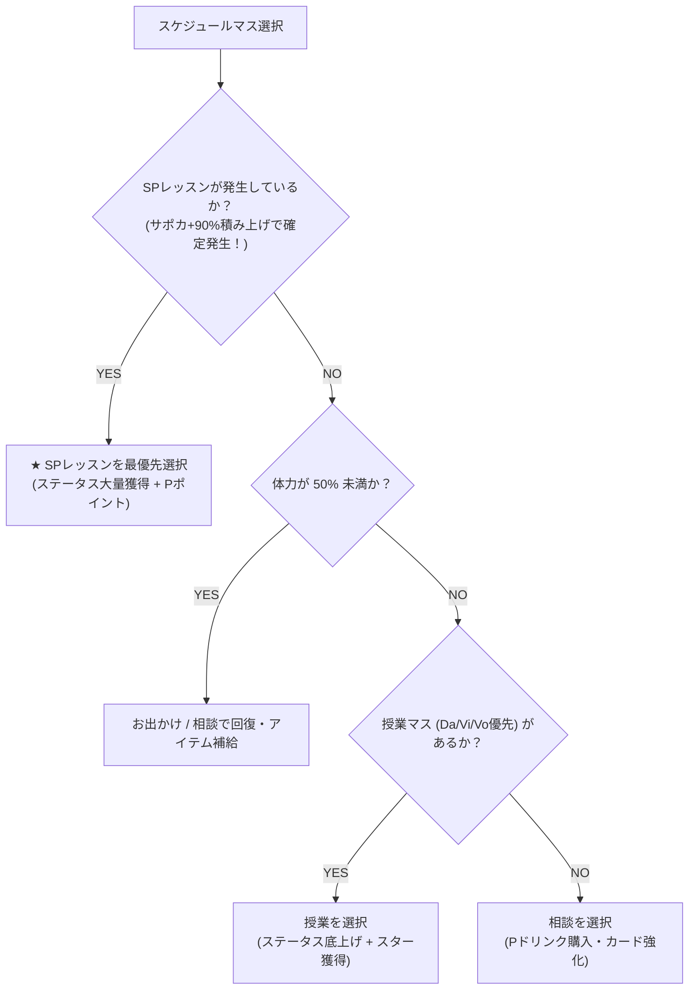
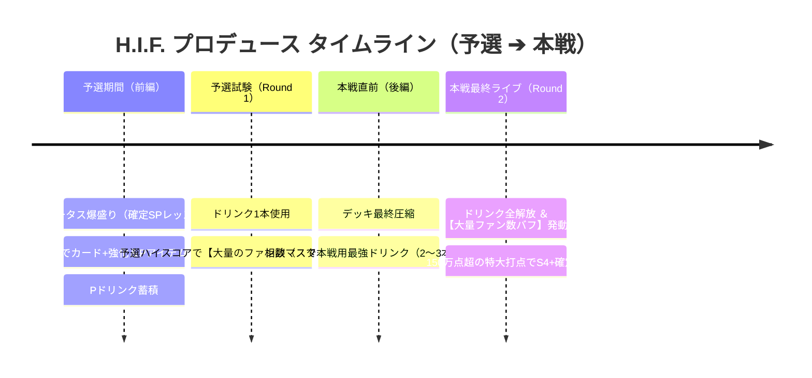

# 04. スケジュール進行・サポートカード編成・リソース管理ノウハウ

## 1. サポートカード編成理論（自前 5枚 ＋ レンタル 1枚）

プロデュース開始前に編成する 6枚のサポートカードは、ステータスの上限到達（カンスト）を左右する最重要要素です。

### 🌟 SP レッスン発生率の重要仕様（確定 100% 化）
- **基礎発生率**: デフォルトで **10%**。
- **確定 100% 化の条件**:
  - サポートカードに記載されている「SPレッスン発生率上昇（例: `vo_sp_lesson_rate`）」の合計値を **+90%** に積み上げることで、基礎 10% ＋ 90% ＝ **100%（毎レッスン確定で SP レッスンが発生）** になります。
  - 確定 SP 化により、通常レッスンを踏むロスを完全にゼロにし、ステータス上昇値と Pポイント獲得量を極限まで引き上げます。

### 🃏 6枚デッキの黄金構成
1. **メイン属性の SP 発生率 UP 持ち（3〜4枚）**:
   - 狙う属性（Vo/Da/Vi）の SPレッスン発生率を合計 +90% 以上確保。
2. **レッスンボーナス ＆ 体力回復持ち（1〜2枚）**:
   - レッスン終了時の固定ステータス加算と体力維持。
3. **レンタル枠（フレンドの完凸 SSR 1枚）**:
   - 自前で不足している SP 発生率や、習得したい重要スキルカード持ちの完凸 Lv50 サポカを借りてデッキを完成させます。

---

## 2. スケジュール選択の優先順位判断

H.I.F. シナリオで総ステータス 7,800〜8,500、スター数 1,000個以上を達成するためのスケジュール選択指針です。

### 📋 アクション別 評価と選び方

| スケジュール | 優先度 | 主なメリット | 選択の目安・注意点 |
| :--- | :---: | :--- | :--- |
| **SP レッスン** | **S (最優先)** | ステータス大幅加算、Pポイント大量獲得 | 得意属性（Vo/Da/Vi）のSPレッスンは逃さず踏む |
| **授業（通常レッスン）** | **A** | 狙った属性のステータス加算、スター獲得 | SPが発生していない週の基本選択肢 |
| **相談（ショップ）** | **A+ (要所)** | Pドリンク購入、不要カード削除、カード強化 | 前編終盤（Round 1 直前）および後編終盤（Round 2 直前）に必ず1回は踏む |
| **お出かけ / 休憩** | **B** | 体力大幅回復、Pアイテム獲得 | 体力が半分を割り、次週のSPレッスンで失敗リスクがある場合に選択 |

---

## 2. Pポイント（コイン）の最適運用法

Pポイントは「相談マス」での戦力強化において最も重要なリソースです。無計画に使わず、以下の優先度で購入・強化を行います。

### 💰 相談マスでの消費優先順位

1. **Round 2 用の強力な Pドリンク購入（最優先）**:
   - 開幕でバフを盛るドリンク（集中+、好印象+、スタンス即時切り替えなど）
   - スコア倍率を跳ね上げるドリンク（絶好調付与、アピール増加）
2. **キーカードの「+」強化**:
   - メイン火力カードや、コスト軽減・ドロー枚数が増えるカードを最優先で強化。
3. **初期不要カード・トラブルカードの削除**:
   - アビリティで除外できない初期の弱いカードを削除し、デッキ密度を高める。

---

## 3. 予選・本戦のタイムラインと Pドリンク・ファン数運用

H.I.F. の真髄は **「予選でファン数（スター）を最大化し、本戦でそのバフを乗せて爆発させる」** ことにあります。

### 🥤 最終試験（Round 2）に持ち込みたい理想のドリンク構成
- **センス**: 『ウメ・プロテイン（集中付与）』 ＋ 『初星ブースト（絶好調付与）』
- **ロジック**: 『特製ジンジャーエール（好印象付与）』 ＋ 『ルイボスティー（元気加算）』
- **アノマリー**: 『エナジードリンク（全力値加算）』 ＋ 『アピールプラス（追加アピール）』

---

## 4. 体力管理とトラブル回避

- **体力 50% 以下の危険水域**:
  - レッスン中に体力不足でメンタル・アクティブカードが使えなくなると、スコア不足でパーフェクト評価を逃し、ステータス上昇値が激減します。
- **トラブルカード（眠気等）への対策**:
  - メモリーアビリティの `card_exclude` を発動させるため、トリガーとなるカード（プライド、アッチェレランド等）を序盤〜中盤のレッスンでも積極的にプレイし、Round 1 / Round 2 突入前に除外を完了させておきます。

